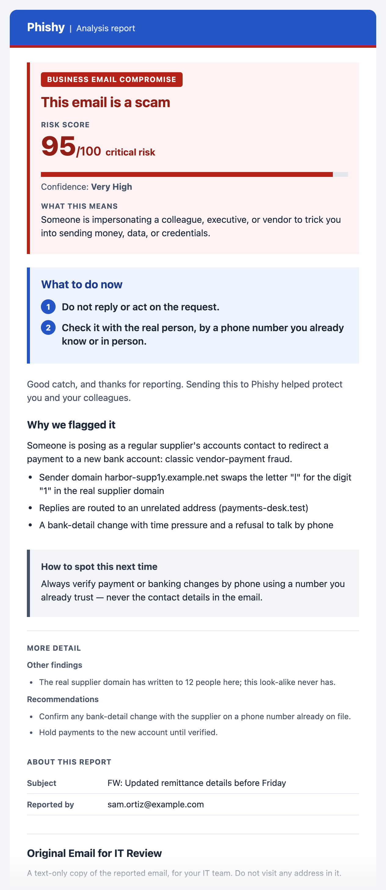
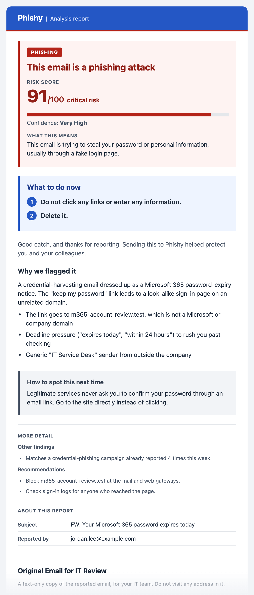
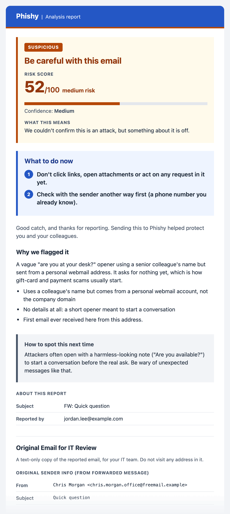
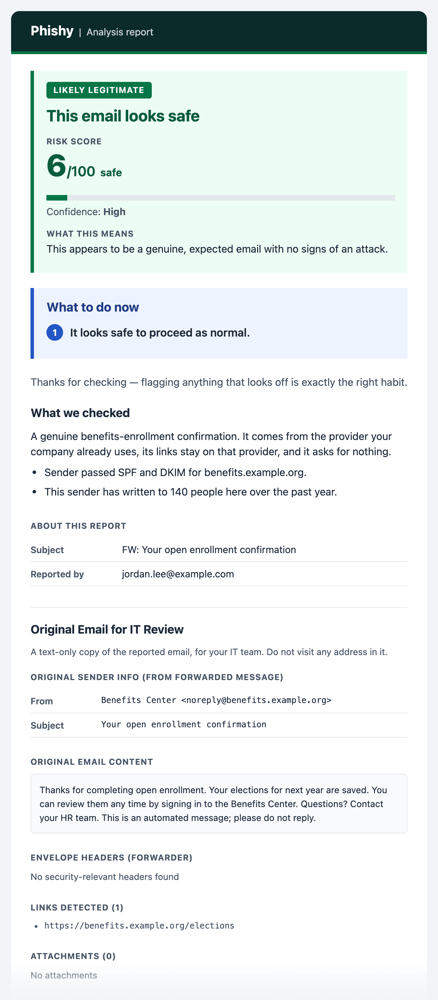
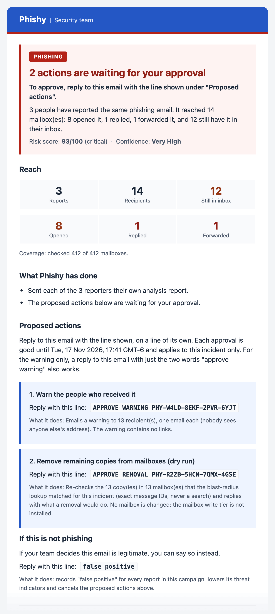
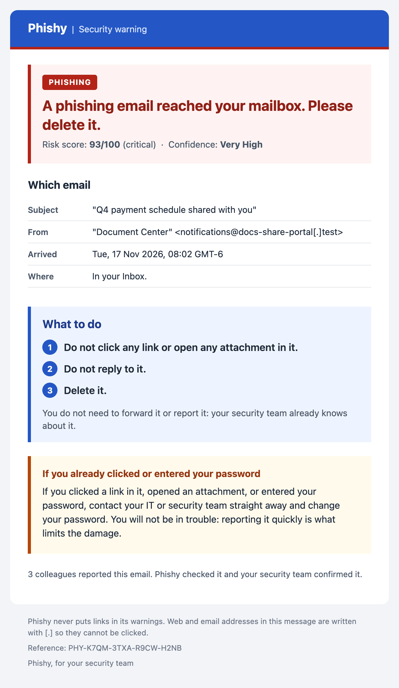

<p align="center">
  
</p>

# Phishy

**Open-source phishing response for your organization.**

[](https://github.com/colinstoner/phishy-email-analyzer/actions/workflows/ci.yml)
[](LICENSE)
[](package.json)

Phishy is a phishing-report desk for your organization, running on AWS Lambda. Employees forward a suspicious email to one address; Phishy analyzes it with Claude (through AWS Bedrock or the Anthropic API) and replies with a plain-language report, copying your security team.

## What it does out of the box

With nothing but SES, S3 and a model:

- **Parses the report as a trust boundary.** Real MIME parsing, forwarded-header extraction (inline forwards and forward-as-attachment), SafeLinks / Proofpoint / other gateway unwrapping, Unicode and hidden-text normalization, link-text-versus-destination checks.
- **Asks Claude for a structured verdict**: `phishing`, `bec`, `malware_delivery`, `suspicious`, `spam`, `graymail` or `legitimate`, with a 0–100 risk score kept inside that verdict's band. The default model is Claude Opus 5.5 (`claude-opus-5-5` / `global.anthropic.claude-opus-5-5`); a request the model declines is retried once on Claude Opus 4.8.
- **Replies to the reporter** with what to do, why it was flagged and how to spot it next time, with a forensic section for the security team. An analysis that could not be completed says so ("ANALYSIS UNAVAILABLE") instead of calling the email safe.
- **Reports cost**: per-analysis token and estimated-cost metrics in CloudWatch (namespace `Phishy`), no database needed.
- **Only answers your own people**: reports are accepted from, and sent to, addresses on your configured safe domains only.

## Try it in 60 seconds (no AWS required)

```bash
git clone https://github.com/colinstoner/phishy-email-analyzer && cd phishy-email-analyzer
npm install
npm run try examples/sample-phish.eml          # dry run: parsing, link unwrapping, obfuscation flags
ANTHROPIC_API_KEY=sk-ant-... npm run try examples/sample-phish.eml   # + a real Claude verdict
```

The dry run shows what the deployed function would see: MIME parsing, forwarded-header extraction, link unwrapping and content-integrity flags, on a bundled fictional sample. Point it at any `.eml` you export from your mail client.

## What Reports Look Like

Every reporter gets a plain-language reply: a tone-colored verdict, a 0–100 risk score, what to do, why it was flagged, and a "how to spot this next time" tip — plus a forensic section for the security team. _(Examples below use invented data.)_

| | |
|---|---|
|  |  |
|  |  |

With campaign response on, an outbreak becomes an incident: the security team gets one email to decide from, and the people who received the attack get a short warning once the team approves it.

| | |
|---|---|
|  |  |
| **Incident email:** reach, what Phishy did, and the exact reply line that approves each action. | **Employee warning:** which email, what to do, and what to do if you already clicked. |

Screenshots are rendered from the real email templates with invented data; see [examples/README.md](examples/README.md) to regenerate them.

## Optional layers

Each is off by default and switched on with its own setting ([feature-flag table](docs/CONFIGURATION.md#feature-flags-at-a-glance)).

| Layer | What it adds | Needs |
|---|---|---|
| Enterprise profile | VIPs, partners, your domains and known threats as context for the model | a JSON profile in S3 |
| Threat intelligence | analyses, indicators and campaigns stored; known indicators raise later scores | PostgreSQL 13+ |
| Campaign alerts | one broadcast warning when several people report the same email | the database |
| Verdict cache | repeat reports of one campaign reuse the first verdict, at no model cost | the database + migration 003 |
| Email commands | the security team confirms or overturns a verdict by replying to a report | the database + migration 002 |
| Campaign response | an incident email per campaign, a targeted warning to the people who received it, actions approved by reply | campaign alerts, migration 006, email commands; blast radius for targeted warnings |
| Agentic analysis | Claude may consult Phishy's own data (known indicators, active campaigns, URL structure, the profile) before its verdict | nothing extra |
| Attachment analysis | static inspection of attachment bytes: real type, macros, forms, PDF actions, archive contents, extracted text | nothing extra (in process, no network) |
| Checklist scoring (experimental) | a risk score computed by code from a fixed checklist; weights not yet calibrated | nothing extra |
| Outlook Report button | Report-button submissions handled silently: analyzed, the security team told only when it matters | Microsoft 365 user-reported settings delivering to Phishy |
| Microsoft Graph reads | the original message's real headers, the sender's history with you, who else received a malicious email | a read-only Entra app registration with a certificate |
| Scheduled fan-out scan | an alert (no model) when a known external sender suddenly mails many of your people, before anyone reports it | Graph, the database + migration 005 |

## How the security team works with Phishy

- **Reports** arrive in the security team's inbox as a Cc (or, for malicious verdicts with blast radius on, as their own copy listing who else received the email).
- **Verdict commands**: reply to a report with "confirmed phishing" or "false positive". Phishy records the ruling, adjusts the indicators from that email, applies it to the whole campaign and replies with what it did.
- **Approvals** (campaign response): each incident email lists proposed actions, each with its exact reply line, `APPROVE WARNING <reference>` or `APPROVE REMOVAL <reference>`. A reply whose own text is just `APPROVE WARNING` approves the warning that email proposed. Removal is a **dry run** by default: Phishy replies with what it would remove and changes no mailbox. With the optional mailbox write tier, an approved removal moves the copies to Deleted Items.

Commands and approvals are accepted only from addresses in `SECURITY_TEAM_DISTRIBUTION` or `SECURITY_TEAM_MEMBERS` (optional: individual team members on your safe domains, never emailed) whose mail passes SES SPF or DKIM checks.

## Safety design, briefly

- **The suspicious email is hostile data everywhere.** It reaches the model only inside a nonce-fenced section labelled as the sender's claims; Phishy's own computed facts are labelled separately; email content is kept out of info-level logs. An [injection eval](docs/INJECTION_EVAL.md) measures how well that holds, and its dry run runs in CI.
- **Code decides, the model advises.** Agentic tools touch only Phishy's own data or pure computation, never the network. Graph access is code-driven, fixed-endpoint and read-only; in the SAM deployment a separate broker function holds the Graph certificate and the function that parses email holds none.
- **Reads and writes are separated.** The only Graph write, moving approved copies to Deleted Items, lives in an optional third function with its own app registration and certificate, its own kill switch (off by default) and one typed operation; the main function and the read broker never hold that credential.
- **Approvals are exact-form and never model-interpreted**, use unguessable per-action references that expire, and never widen the approved scope. Warnings go only to in-scope recipients on your safe domains, never to addresses taken from the email.

The full trust model is in [docs/ARCHITECTURE.md](docs/ARCHITECTURE.md).

## How it works

```
employee forwards ─▶ SES ─▶ S3 (raw email)
                       └──▶ Lambda: parse ─▶ optional lookups ─▶ Claude ─▶ risk fusion ─▶ SES reply
                                                                                └─▶ optional: database, campaigns, security-team emails
```

1. SES receives the forward, stores the raw message in S3 and invokes the function.
2. The function parses it into labelled facts, runs whichever optional lookups are on, and asks the model for a verdict.
3. Risk fusion combines the model's verdict with Phishy's own signals (security-team rulings, known indicators, active campaigns, decisive attachment findings) under fixed rules.
4. The report goes back to the employee, with the security team in Cc.

## Setup

- **[docs/QUICK_START.md](docs/QUICK_START.md)**: deploy the core with the SAM template (`sam build && sam deploy --guided`), then verify your domain in SES and activate the receipt rule set.
- **[AWS.md](AWS.md)**: every SAM parameter, the optional database and Graph deployment, and a fully manual setup.
- **[docs/CONFIGURATION.md](docs/CONFIGURATION.md)**: every setting and environment variable.

Minimum settings for a working deployment:

```bash
PHISHY_AI_PROVIDER=bedrock            # or ANTHROPIC_API_KEY=sk-ant-...
S3_BUCKET_NAME=my-phishy-emails
SENDER_EMAIL=phishy@example.com
SAFE_DOMAINS=example.com              # whose reports are answered
SECURITY_TEAM_DISTRIBUTION=security@example.com
```

## Documentation

| Document | Description |
|----------|-------------|
| [docs/QUICK_START.md](docs/QUICK_START.md) | Deploy the core |
| [AWS.md](AWS.md) | AWS setup (SAM and manual), optional layers, costs |
| [docs/CONFIGURATION.md](docs/CONFIGURATION.md) | Every configuration option and feature flag |
| [docs/ARCHITECTURE.md](docs/ARCHITECTURE.md) | How Phishy works: pipeline, trust boundaries, each optional layer |
| [docs/INTELLIGENCE.md](docs/INTELLIGENCE.md) | Threat intelligence: indicators, campaigns, the audit CLI |
| [docs/DATABASE.md](docs/DATABASE.md) | Intelligence database schema and migrations |
| [docs/GRAPH_PROBE.md](docs/GRAPH_PROBE.md) | Read-only probe: which Microsoft Graph calls work in your tenant |
| [docs/INJECTION_EVAL.md](docs/INJECTION_EVAL.md) | Measuring prompt-injection resistance per model |
| [CHANGELOG.md](CHANGELOG.md) | What changed, including what is not yet released |

## Development

Node.js 22 (the Lambda runtime; see `.nvmrc`). No AWS account or API key is needed to build or test: AWS and model calls are mocked.

```bash
npm install
npm run build
npm test
npm run lint
npm run format:check
npm run eval:injection -- --dry-run --model x   # builds and checks every eval prompt; no model call
npm run package        # the Lambda zips SAM would build, for a deployment without SAM (dist/lambda/)
```

See [CONTRIBUTING.md](CONTRIBUTING.md) for the project layout and pull-request process.

## License

[Apache-2.0](LICENSE)

## Contributing

Contributions are welcome! See [CONTRIBUTING.md](CONTRIBUTING.md) for development setup, coding standards, and the pull request process.

Found a security vulnerability? Please report it privately — see [SECURITY.md](SECURITY.md).
